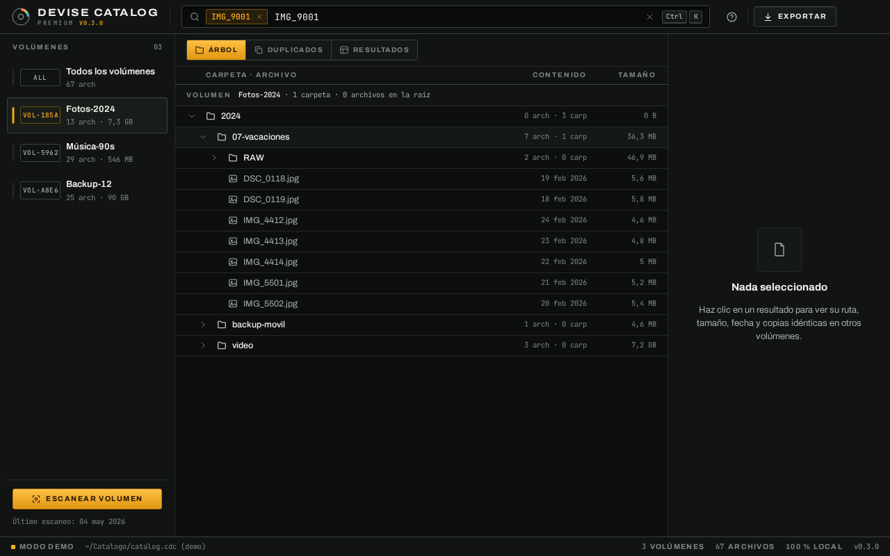
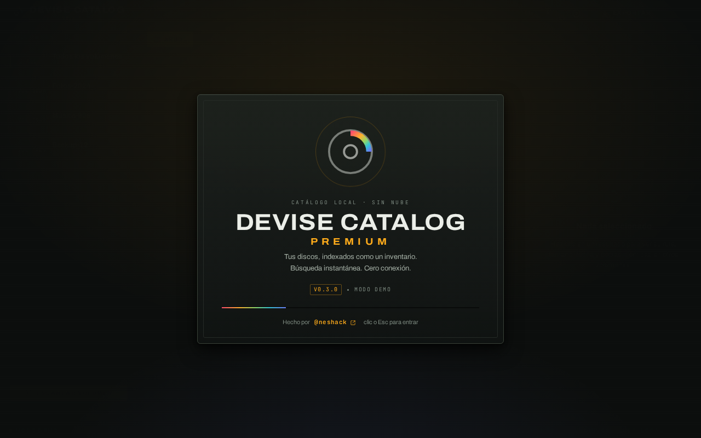
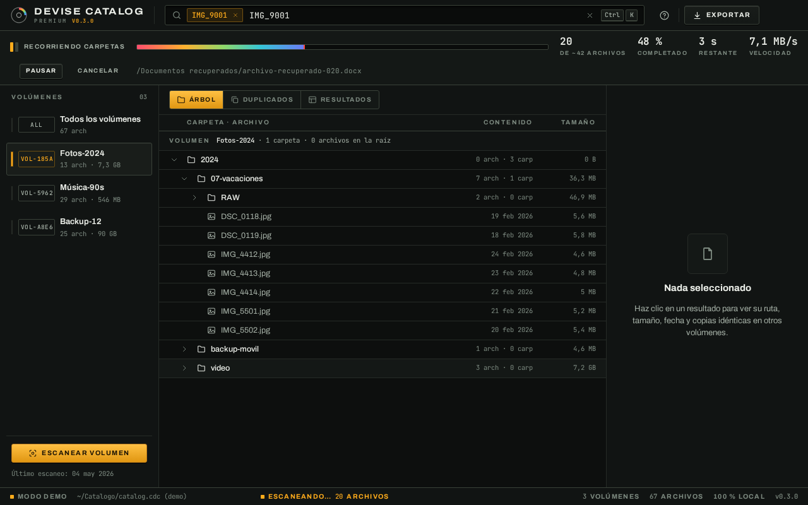
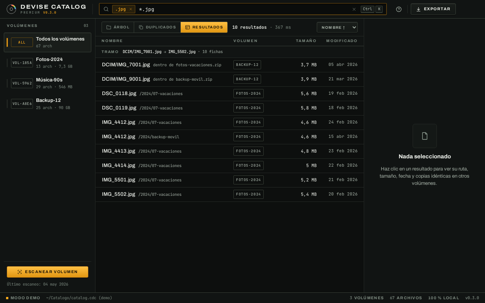
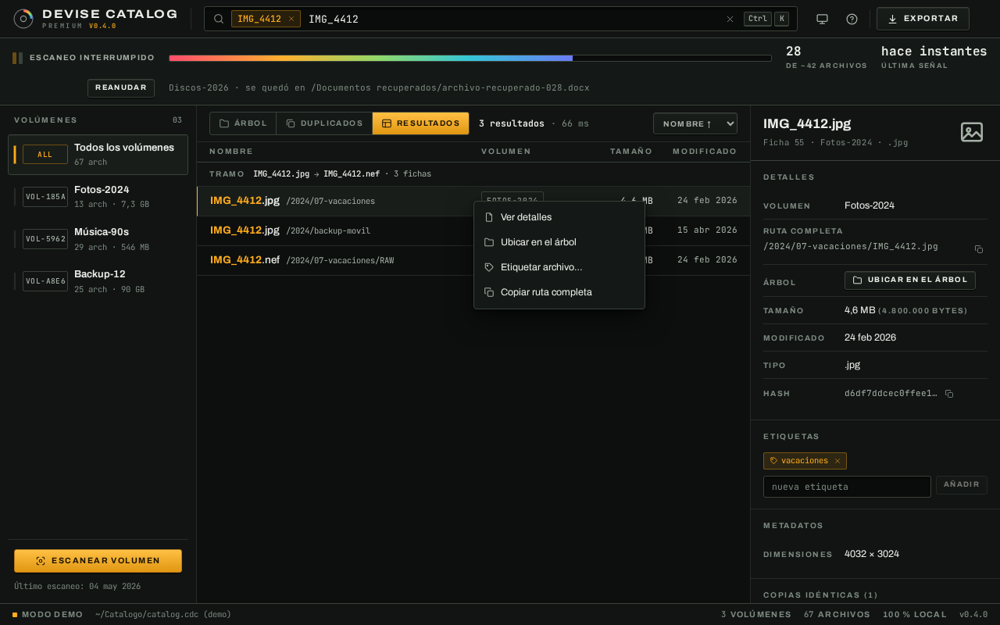
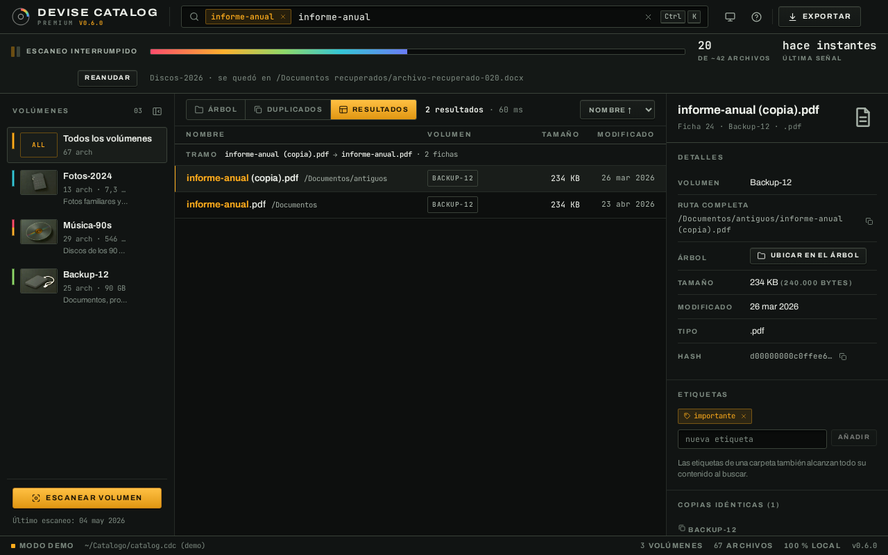
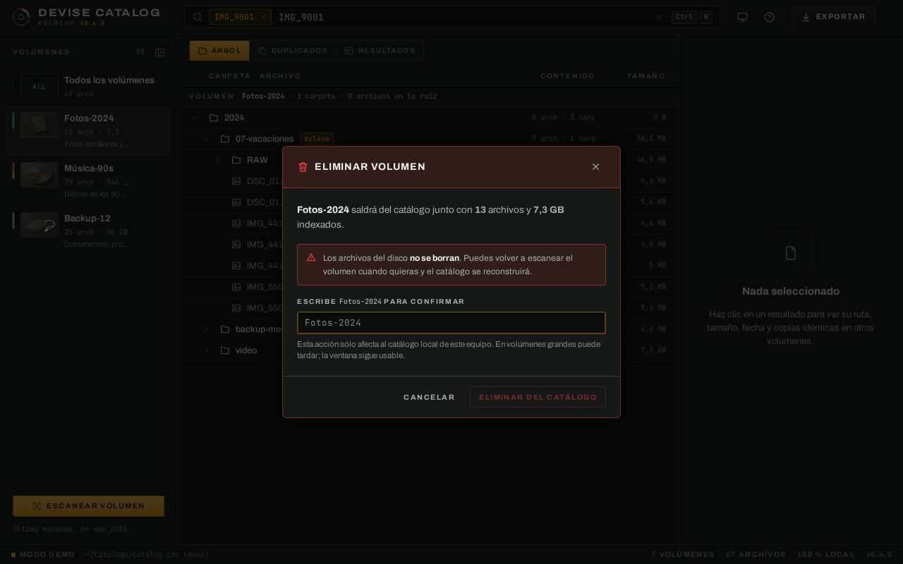
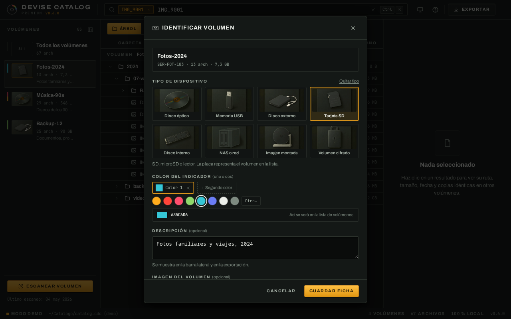
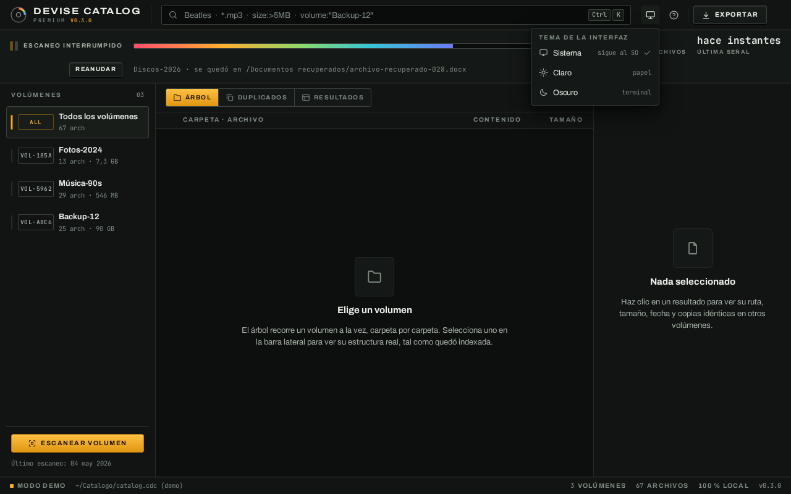
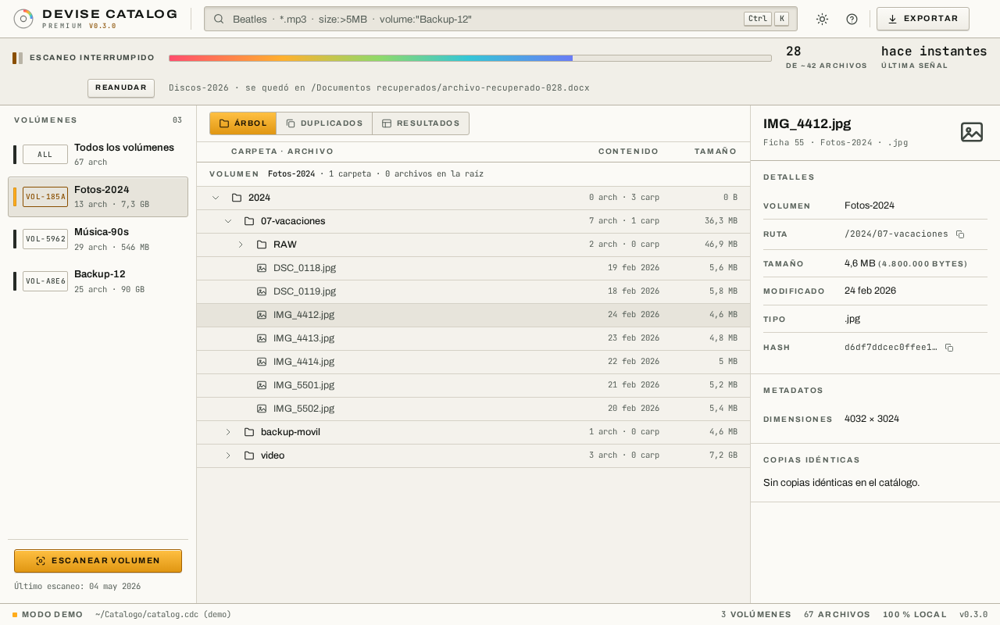

# Devise Catalog Premium

[Español](README.md) · **English**

[](https://github.com/neshack/devise-catalog-premium/actions/workflows/ci.yml)
[](LICENSE)
[](https://github.com/neshack/devise-catalog-premium/releases)

An offline-first desktop catalog for the media you keep in a drawer: burned
discs, USB drives, external disks, NAS folders and ZIP archives. Scan a volume
once, then ask **where a file lives** months later without inserting the media.

The catalog is a single portable `.cdc` file (SQLite WAL + FTS5). No account,
no telemetry, no network calls at runtime.

> Formerly **CD Catalog Premium**. The app data directory and package name
> changed in 0.3.0; the first launch copies the old catalog automatically.



## Why another file indexer?

Because the answer to "where is that file?" should not depend on the disk being
plugged in, on a cloud account, or on a service that may disappear. Devise
Catalog is a local inventory: one file you can copy, back up, carry on a USB
stick, and search at any time.

## Features

- **Volume scan** with differential re-scans: unchanged files are never read
  again; removed files are pruned.
- **Full-text search** with filters for extension, size and volume
  (`*.mp3`, `ext:{flac,wav}`, `size:>500MB`, `volume:"Backup-12"`).
- **Tree view** as the primary browser: one volume at a time, one level per
  query, so opening a million-file volume costs one level, not a million rows.
- **Archive entries** from ZIP central directories, indexed without extracting.
- **Duplicates** by BLAKE3 content hash across volumes.
- **Tags** on files and folders, searchable with `#tag` or `tag:tag`; a folder
  tag applies to everything inside it.
- **Locate in tree** from any result's context menu, opening every folder above
  it and leaving the file selected.
- **Volume identity**: a device type from eight bundled plates (optical, USB,
  external, SD, internal, NAS, mounted image, encrypted) and one or two
  indicator colors drawn in the sidebar.
- **Inspector** with the full path, size, date, hash, audio metadata (ID3 via
  `lofty`) and image metadata (EXIF via `rexif`). Duplicate paths are shown in
  full, not truncated.
- **Resilient scans**: pause, resume, cancel, and continue after the process
  was killed or the machine suspended.
- **Safe volume removal**: typing the label is required; the disk is never
  touched.
- **Exports** to CSV, JSON and HTML.
- **100 % local** and keyboard-first.
- **Light, dark or system theme**, applied before the first paint and remembered
  across launches.

<p align="center">
  
  
</p>
<p align="center">
  
  
</p>
<p align="center">
  
  
</p>
<p align="center">
  
</p>

### Themes

The interface follows the operating system by default and can be pinned to
light or dark from the header. The choice survives restarts; the system option
keeps listening to the OS while the app is open.

<p align="center">
  
  
</p>

## Install

Download the latest installer from
[Releases](https://github.com/neshack/devise-catalog-premium/releases).

| Platform | Artifact |
|---|---|
| Linux (Fedora/RHEL) | `.rpm` |
| Linux (Debian/Ubuntu) | `.deb` |
| Linux (portable) | `.AppImage` |
| Windows | `.msi` / `.exe` |
| macOS (Apple Silicon) | `.dmg` |

Linux packages are unsigned by design: `.deb` and `.AppImage` have no OS-level
signature check. Windows and macOS builds are signed only when the release
secrets are configured (see [`.github/workflows/release.yml`](.github/workflows/release.yml)).

### Upgrading from CD Catalog Premium

The 0.3.0 rename changes the bundle identifier from `com.cdcatalog.premium` to
`com.devise.catalog`. On first launch, Devise Catalog copies the old
`catalog.cdc` (and its SQLite WAL files) into the new data directory. The old
application can then be uninstalled; the new one keeps working with the copied
catalog.

## Build from source

Requirements:

| Requirement | Version | Notes |
|---|---|---|
| Rust stable | ≥ 1.87 | `rustup` recommended |
| Node.js | ≥ 20 | includes `npm` |
| Linux | WebKitGTK 4.1 + build tools | `sudo apt install libwebkit2gtk-4.1-dev build-essential curl wget file libssl-dev libayatana-appindicator3-dev librsvg2-dev` |
| Windows | WebView2 | preinstalled on Windows 10/11 |
| macOS | Xcode Command Line Tools | `xcode-select --install` |

```bash
git clone https://github.com/neshack/devise-catalog-premium.git
cd devise-catalog-premium
npm ci
npm run tauri dev
```

Frontend-only demo mode (no Rust backend, seeded data):

```bash
npm run dev   # http://localhost:1420
```

Production bundles:

```bash
npm run tauri build
# artifacts in src-tauri/target/release/bundle/
```

On distributions whose libraries carry `.relr.dyn`, the AppImage step can fail
inside `linuxdeploy`'s bundled `strip`. The `.deb` and `.rpm` still build; use
`NO_STRIP=1 npm run tauri build` to produce the AppImage too.

## Use

1. Click **Escanear volumen**.
2. Enter an absolute root (`/media/backup`, `D:\`, a mounted NAS path…), a
   label, and optionally a serial.
3. Watch the scan strip: phase, current file, files seen, percentage, speed and
   remaining time. Pause, resume or cancel at any time.
4. Select the volume in the sidebar and browse it in **Árbol**, or search from
   the top bar (`Ctrl+K`).

Search examples:

```text
*.mp3
informe size:>5MB
ext:{mp3,flac} size:<10MB
volume:"Backup-12"
tag:playa
#familia
Beatles
```

The catalog file is resolved in the platform app-data directory. The interface
is in Spanish; code, comments and commits are in English.

## Architecture

```text
src-tauri/
  src/main.rs, lib.rs, commands/{scan,search,tree,tags,export,system}.rs
  crates/core-db       SQLite WAL + FTS5, differential upsert, tree queries
  crates/core-scanner  cancellable jwalk walk with progress + error reporting
  crates/core-hash     BLAKE3 partial/full hashing
  crates/core-parsers  ID3 (lofty), EXIF (rexif), ZIP central directory
  crates/core-export   CSV / JSON / HTML with escaping
src/
  lib/                 IPC, types, formatting, query parser, demo catalog
  stores/catalog.ts    Zustand state: search, volumes, tree, scan, toasts
  components/          SearchBar, VolumeSidebar, TreeView, ResultsList,
                       Inspector, DuplicatesPanel, ReadingStrip, Splash…
tests/e2e/             Playwright against demo mode
scripts/               capture.mjs, icon.mjs, seed_large.py, signing wizard
```

The scan pipeline is deliberately free of Tauri types so it can be tested
without a window. The UI has a demo mode that mirrors the backend command
semantics, which is what the Playwright suite runs against.

## Tests

```bash
# Frontend
npx tsc --noEmit
npx vitest run
npm run build

# E2E (starts Vite on :1420)
npx playwright test

# Rust (from src-tauri/)
cargo fmt --all -- --check
cargo clippy --workspace --all-targets -- -D warnings
cargo test --workspace

# FTS5 micro-benchmark
cargo bench -p core-db -- --sample-size 10 --measurement-time 1
```

## Status and known limits

- ✅ Differential scans, FTS5 search, tree, duplicates, exports, ZIP entries.
- ✅ Pause/resume/cancel and recovery of interrupted scans.
- ✅ Safe volume removal and automatic migration from the old app identity.
- ✅ Per-volume device type and indicator colors.
- 🔜 7z and ISO container parsers (ZIP is the only container today).
- 🔜 Archive entries are indexed but not hashed, so they do not participate in
  duplicate detection until extracted.
- 🔜 No auto-updater and no signed Linux package repository yet.
- Windows/macOS code signing is wired in CI but requires purchased
  certificates; without secrets the workflow ships unsigned builds.

## Contributing

Issues and pull requests are welcome. Read [CONTRIBUTING.en.md](CONTRIBUTING.en.md)
and the [Code of Conduct](CODE_OF_CONDUCT.en.md) first. Security reports go
through [SECURITY.en.md](SECURITY.en.md), not public issues. Maintainers can find
the release checklist in [docs/PUBLISHING.en.md](docs/PUBLISHING.en.md).

## License

[MIT](LICENSE) © 2026 Nestor Peña.

The bundled fonts (Archivo and JetBrains Mono) are licensed under the SIL Open
Font License; their license files live in `src/assets/fonts/`.

Built by [@neshack](https://x.com/neshack).
