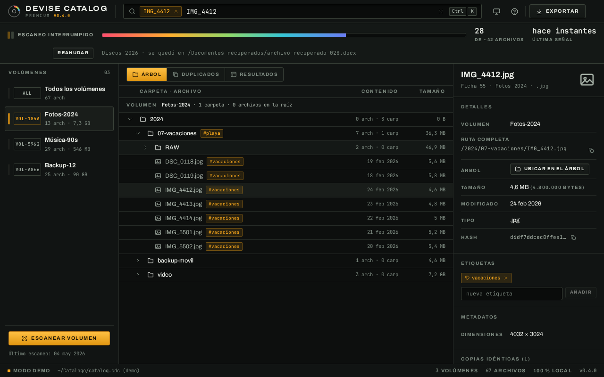
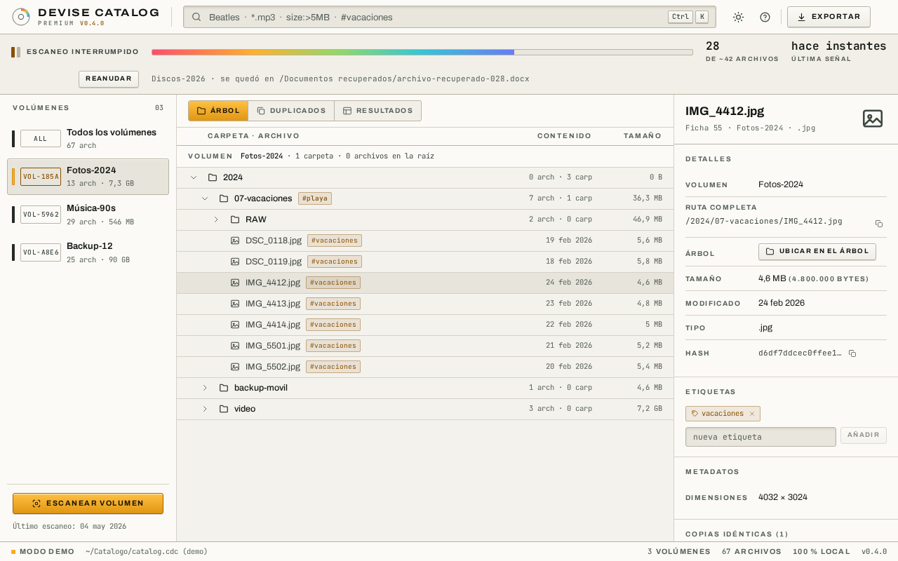

# Devise Catalog Premium

[](https://github.com/neshack/devise-catalog-premium/actions/workflows/ci.yml)
[](LICENSE)

Catálogo de escritorio **100 % local** para los discos, USB, NAS y ZIP que
guardas en un cajón. Escanea un volumen una vez y busca dónde vive un archivo
meses después, sin insertar el disco.

El catálogo es un único archivo portable `.cdc` (SQLite WAL + FTS5). Sin
cuentas, sin telemetría, sin red en tiempo de ejecución.

> Antes llamado **CD Catalog Premium**. En 0.3.0 cambiaron el identificador y el
> nombre del paquete; el primer arranque copia automáticamente el catálogo
> anterior.



## Qué incluye

- Escaneo diferencial: relee solo lo que cambió y elimina lo que ya no existe.
- Búsqueda full-text con filtros por extensión, tamaño y volumen.
- Árbol como vista principal: un volumen a la vez, un nivel por consulta.
- Entradas de ZIP indexadas sin extraer.
- Duplicados por hash BLAKE3 entre volúmenes.
- Etiquetas en archivos y carpetas, buscables con `#tag` o `tag:tag`; una
  etiqueta de carpeta alcanza todo su contenido.
- **Ubicar en el árbol** desde el menú contextual de cualquier resultado.
- Inspector con ruta completa, tamaño, fecha, hash, ID3 y EXIF; las rutas de
  las copias también se ven completas.
- Escaneos que se pausan, se reanudan y sobreviven a un cierre o suspensión.
- Eliminación segura de volúmenes: hay que escribir la etiqueta; el disco no se toca.
- Exportación a CSV, JSON y HTML.
- Tema claro, oscuro o del sistema, aplicado antes del primer pintado y recordado
  entre arranques.
- Sin cuentas, sin telemetría y sin llamadas de red.

## Tema

La interfaz sigue al sistema operativo por defecto y se puede fijar en claro u
oscuro desde la cabecera. La elección sobrevive al reinicio; la opción Sistema
sigue escuchando al SO mientras la app está abierta.



## Instalar

Descarga el instalador desde
[Releases](https://github.com/neshack/devise-catalog-premium/releases).

| Plataforma | Artefacto |
|---|---|
| Fedora/RHEL | `.rpm` |
| Debian/Ubuntu | `.deb` |
| Linux portable | `.AppImage` |
| Windows | `.msi` / `.exe` |
| macOS | `.dmg` / `.app` |

Los paquetes de Linux van sin firma a propósito: `.deb` y `.AppImage` no tienen
verificación de firma a nivel de sistema. Windows y macOS se firman solo si los
secretos de release están configurados.

### Actualizar desde CD Catalog Premium

El cambio de nombre mueve el identificador de `com.cdcatalog.premium` a
`com.devise.catalog`. En el primer arranque, Devise Catalog copia el
`catalog.cdc` anterior (y sus archivos WAL) a la carpeta nueva. Después puedes
desinstalar la app vieja sin perder el catálogo.

## Compilar

Requisitos: Rust estable ≥ 1.87, Node.js ≥ 20 y las dependencias de Tauri
(WebKitGTK 4.1 en Linux; WebView2 en Windows; Xcode CLT en macOS).

```bash
git clone https://github.com/neshack/devise-catalog-premium.git
cd devise-catalog-premium
npm ci
npm run tauri dev
```

Solo frontend, con catálogo de demostración:

```bash
npm run dev   # http://localhost:1420
```

Instaladores de producción:

```bash
npm run tauri build
# quedan en src-tauri/target/release/bundle/
```

Si el AppImage falla dentro de `linuxdeploy` por `.relr.dyn`, usa
`NO_STRIP=1 npm run tauri build`; `.deb` y `.rpm` se generan igual.

## Uso

1. **Escanear volumen** → ruta absoluta, etiqueta y serial opcional.
2. La tira de escaneo muestra fase, archivo actual, archivos vistos, porcentaje,
   velocidad y tiempo restante. Puedes pausar, reanudar o cancelar.
3. Elige el volumen en la barra lateral y recórrelo en **Árbol**, o busca con
   `Ctrl+K`.

```text
*.mp3
informe size:>5MB
ext:{mp3,flac} size:<10MB
volume:"Backup-12"
tag:playa
#familia
Beatles
```

La interfaz está en español; el código, los comentarios y los commits en inglés.

## Arquitectura

```text
src-tauri/
  src/commands/{scan,search,tree,tags,export,system}.rs
  crates/core-db       SQLite WAL + FTS5, upsert diferencial, consultas de árbol
  crates/core-scanner  recorrido jwalk cancelable con progreso y errores
  crates/core-hash     BLAKE3 parcial/completo
  crates/core-parsers  ID3 (lofty), EXIF (rexif), ZIP
  crates/core-export   CSV / JSON / HTML
src/
  lib/                 IPC, tipos, formato, parser de consultas, modo demo
  stores/catalog.ts    Zustand: búsqueda, volúmenes, árbol, escaneo, toasts
  components/          SearchBar, VolumeSidebar, TreeView, ResultsList,
                       Inspector, DuplicatesPanel, ReadingStrip, Splash…
tests/e2e/             Playwright sobre el modo demo
```

## Pruebas

```bash
npx tsc --noEmit
npx vitest run
npx playwright test
cd src-tauri
cargo fmt --all -- --check
cargo clippy --workspace --all-targets -- -D warnings
cargo test --workspace
```

## Estado y límites

- ✅ Escaneo diferencial, búsqueda FTS5, árbol, duplicados, exportación y ZIP.
- ✅ Pausa/reanudación y recuperación de escaneos interrumpidos.
- ✅ Eliminación segura y migración desde la identidad anterior.
- 🔜 Parsers de 7z e ISO (hoy solo ZIP).
- 🔜 Las entradas de archivo se indexan sin hash: no entran en duplicados hasta extraerlas.
- 🔜 Sin auto-updater ni repositorio de paquetes Linux firmado con GPG.
- La firma de Windows/macOS está cableada en CI, pero requiere certificados
  comprados; sin secretos el workflow publica builds sin firmar.

## Contribuir

Lee [CONTRIBUTING.md](CONTRIBUTING.md) y el
[Código de Conducta](CODE_OF_CONDUCT.md). Los reportes de seguridad van por
[SECURITY.md](SECURITY.md), no por issues públicos.

## Licencia

[MIT](LICENSE) © 2026 Nestor Peña.

Las tipografías incluidas (Archivo y JetBrains Mono) están bajo la SIL Open
Font License; sus licencias viven en `src/assets/fonts/`.

Hecho por [@neshack](https://x.com/neshack).
