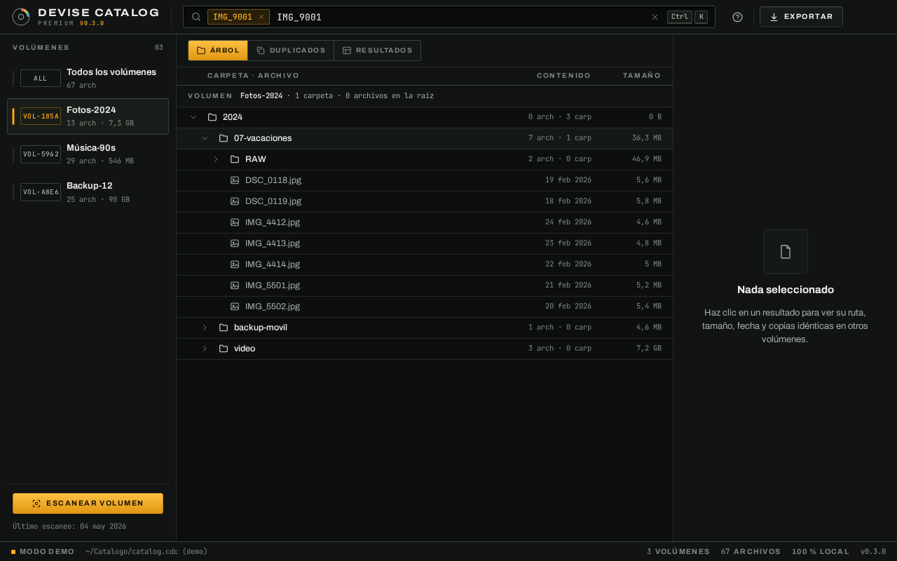
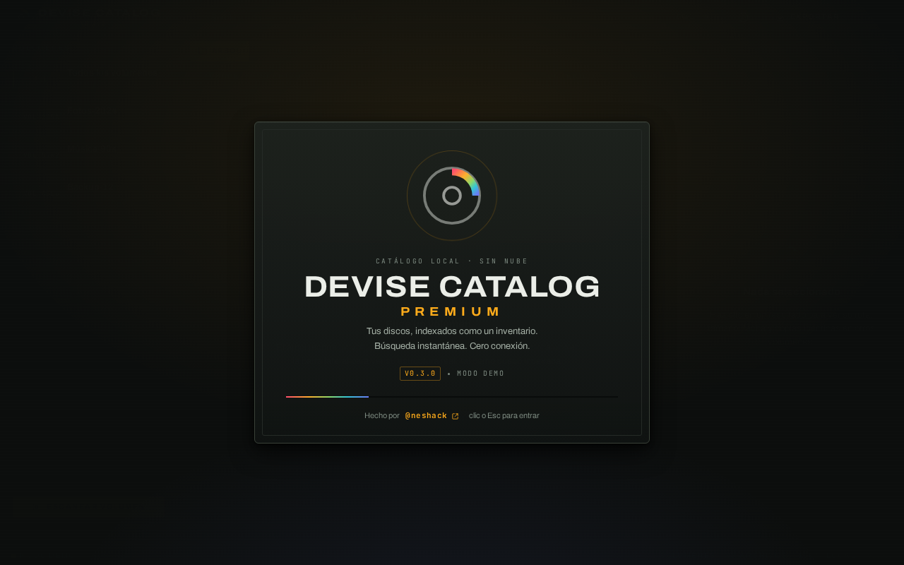
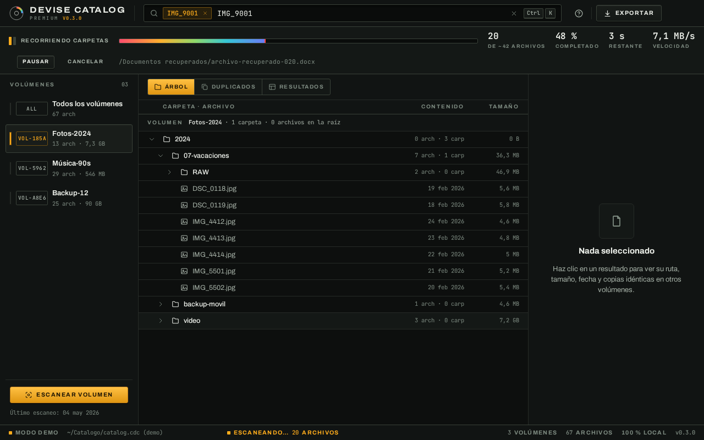
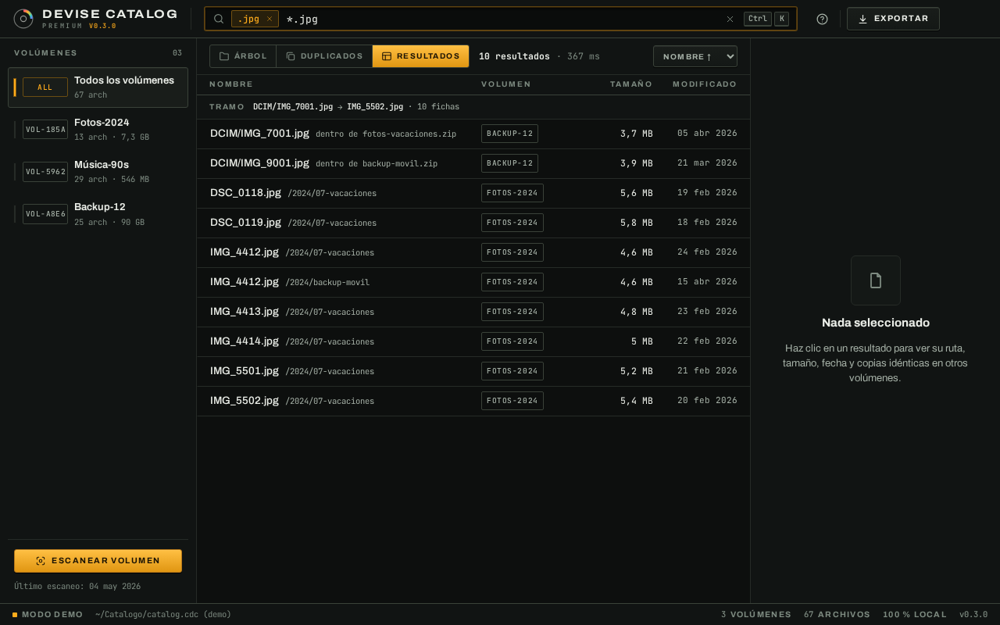
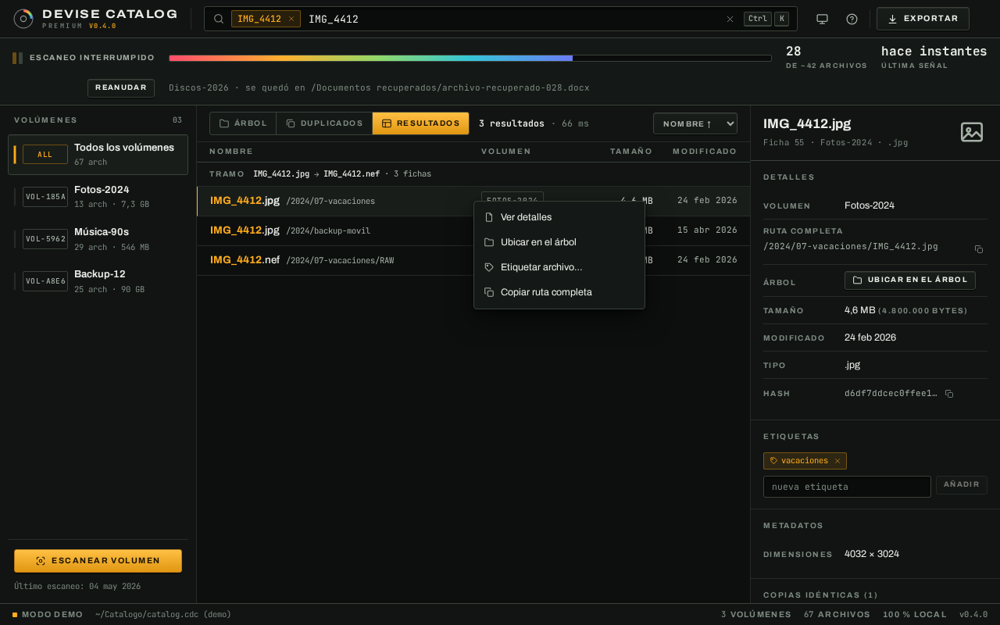
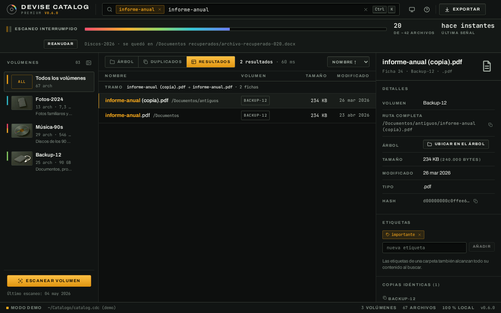
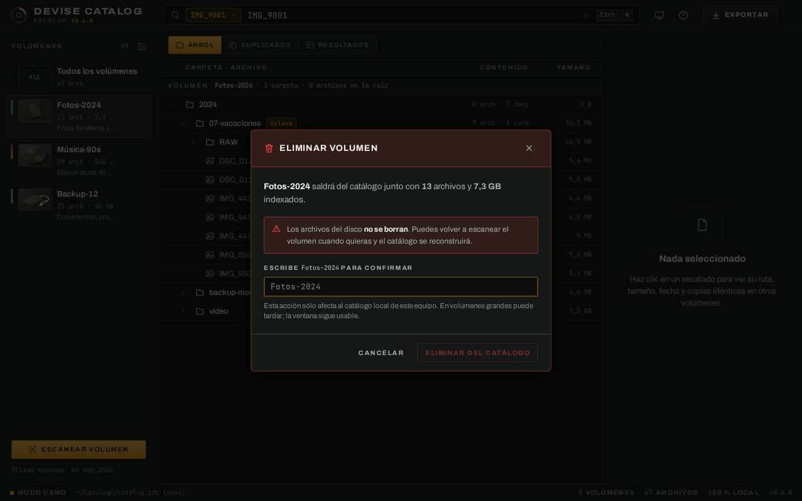
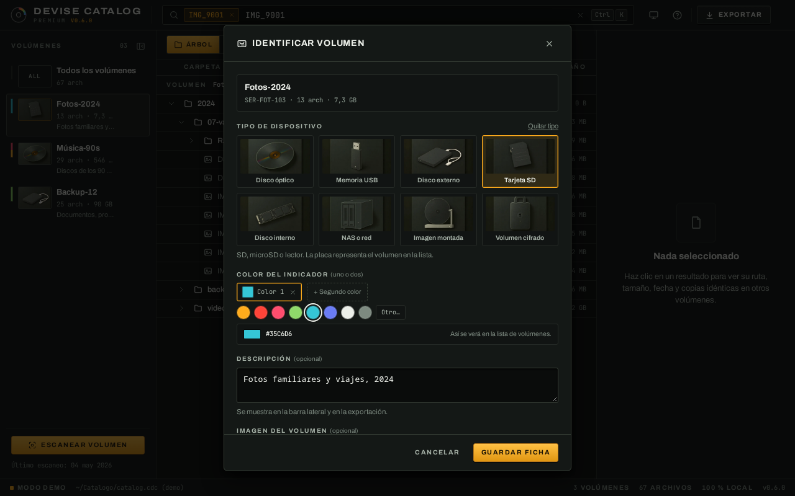
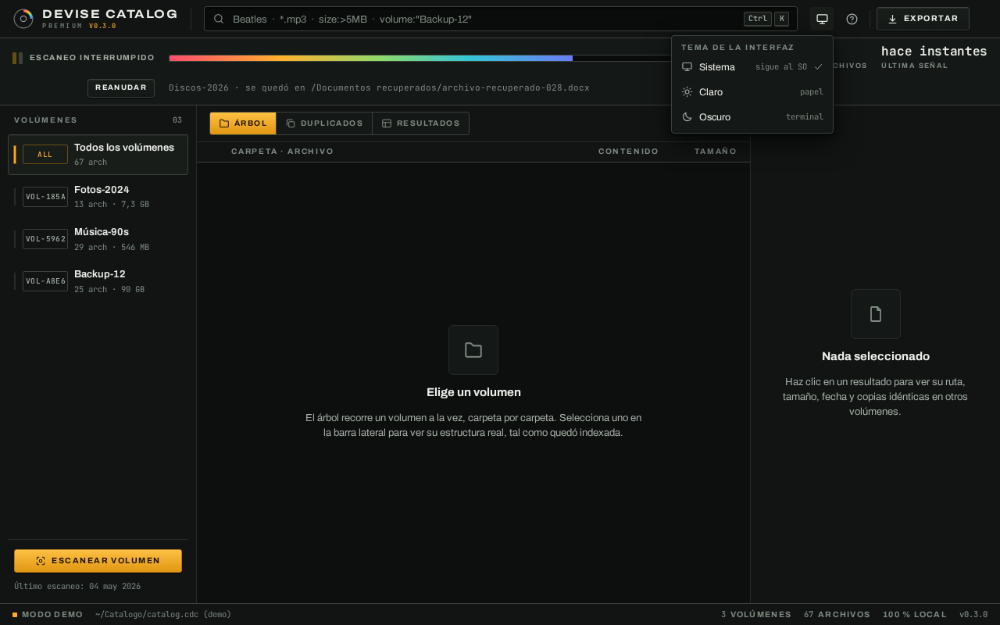
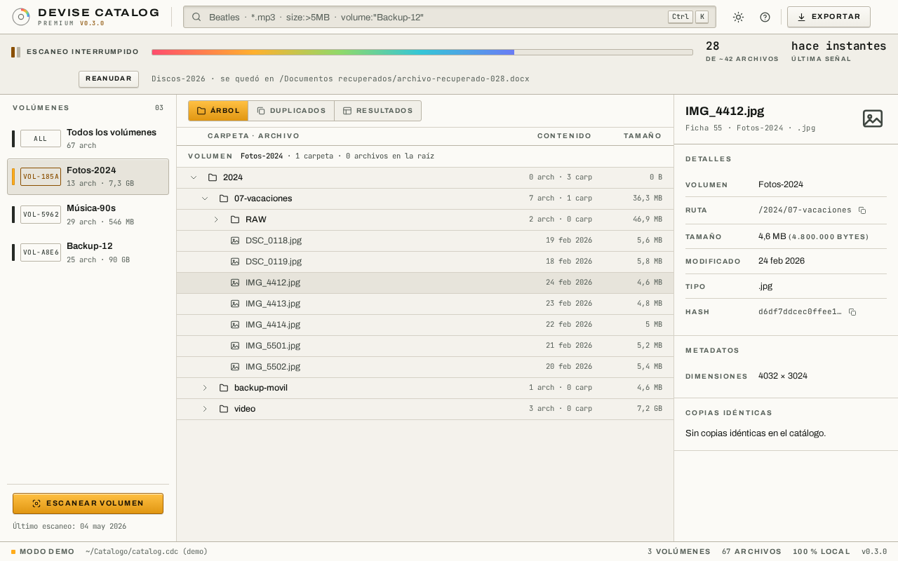

# Devise Catalog Premium

**Español** · [English](README.en.md)

[](https://github.com/neshack/devise-catalog-premium/actions/workflows/ci.yml)
[](LICENSE)
[](https://github.com/neshack/devise-catalog-premium/releases)

Catálogo de escritorio **100 % local** para los discos, USB, NAS y archivos ZIP
que guardas en un cajón. Escanea un volumen una vez y, meses después, pregunta
**dónde vive un archivo** sin insertar el disco.

El catálogo es un único archivo portable `.cdc` (SQLite WAL + FTS5). Sin
cuentas, sin telemetría y sin llamadas de red en tiempo de ejecución.

> Antes se llamaba **CD Catalog Premium**. En 0.3.0 cambiaron el identificador
> del paquete y el nombre; el primer arranque copia el catálogo anterior de
> forma automática.



## ¿Por qué otro indexador de archivos?

Porque la respuesta a "¿dónde está ese archivo?" no debería depender de que el
disco esté conectado, de una cuenta en la nube o de un servicio que puede
desaparecer. Devise Catalog es un inventario local: un archivo que puedes
copiar, respaldar, llevar en una memoria USB y consultar en cualquier momento.

## Funciones

- **Escaneo de volúmenes con re-escaneo diferencial**: los archivos que no
  cambiaron nunca se vuelven a leer; los que ya no existen se eliminan del
  catálogo.
- **Búsqueda de texto completo** con filtros por extensión, tamaño y volumen
  (`*.mp3`, `ext:{flac,wav}`, `size:>500MB`, `volume:"Backup-12"`).
- **Vista de árbol** como navegador principal: un volumen a la vez y un nivel
  por consulta, así que abrir un volumen de un millón de archivos cuesta un
  nivel, no un millón de filas.
- **Entradas de contenedores ZIP** indexadas sin extraer.
- **Duplicados** por hash de contenido BLAKE3 entre volúmenes.
- **Etiquetas** en archivos y carpetas, buscables con `#etiqueta` o
  `tag:etiqueta`; una etiqueta de carpeta alcanza todo lo que contiene.
- **Ubicar en el árbol** desde el menú contextual de cualquier resultado: abre
  todas las carpetas superiores y deja el archivo seleccionado.
- **Ficha de cada volumen**: tipo de dispositivo entre ocho placas incluidas
  (óptico, USB, externo, SD, interno, NAS, imagen montada y cifrado) y uno o dos
  colores de indicador que se dibujan en la barra lateral.
- **Inspector** con ruta completa, tamaño, fecha, hash, metadatos de audio (ID3
  vía `lofty`) y de imagen (EXIF vía `rexif`). Las rutas de los duplicados se
  muestran completas, no truncadas.
- **Escaneos resistentes**: pausar, reanudar, cancelar y continuar después de
  que el proceso se cerró o la máquina se suspendió.
- **Eliminación segura de volúmenes**: hay que escribir la etiqueta; el disco
  nunca se toca.
- **Exportación** a CSV, JSON y HTML.
- **100 % local** y pensado para usarse con el teclado.
- **Tema claro, oscuro o del sistema**, aplicado antes del primer pintado y
  recordado entre arranques.

<p align="center">
  
  
</p>
<p align="center">
  
  
</p>
<p align="center">
  
  
</p>
<p align="center">
  
</p>

### Temas

La interfaz sigue al sistema operativo por defecto y se puede fijar en claro u
oscuro desde la cabecera. La elección sobrevive al reinicio; la opción Sistema
sigue escuchando al sistema operativo mientras la aplicación está abierta.

<p align="center">
  
  
</p>

## Instalar

Descarga el instalador más reciente desde
[Releases](https://github.com/neshack/devise-catalog-premium/releases).

| Plataforma | Artefacto |
|---|---|
| Linux (Fedora/RHEL) | `.rpm` |
| Linux (Debian/Ubuntu) | `.deb` |
| Linux (portable) | `.AppImage` |
| Windows | `.msi` / `.exe` |
| macOS (Apple Silicon) | `.dmg` |

Los paquetes de Linux se publican sin firma a propósito: `.deb` y `.AppImage`
no tienen verificación de firma a nivel del sistema operativo. Las compilaciones
de Windows y macOS se firman solo cuando los secretos del release están
configurados (ver
[`.github/workflows/release.yml`](.github/workflows/release.yml)).

### Actualizar desde CD Catalog Premium

El cambio de nombre de 0.3.0 mueve el identificador del paquete de
`com.cdcatalog.premium` a `com.devise.catalog`. En el primer arranque, Devise
Catalog copia el `catalog.cdc` anterior (y sus archivos WAL de SQLite) al nuevo
directorio de datos. Después puedes desinstalar la aplicación vieja sin perder
el catálogo.

## Compilar desde el código

Requisitos:

| Requisito | Versión | Notas |
|---|---|---|
| Rust estable | ≥ 1.87 | se recomienda `rustup` |
| Node.js | ≥ 20 | incluye `npm` |
| Linux | WebKitGTK 4.1 + herramientas de compilación | `sudo apt install libwebkit2gtk-4.1-dev build-essential curl wget file libssl-dev libayatana-appindicator3-dev librsvg2-dev` |
| Windows | WebView2 | viene preinstalado en Windows 10/11 |
| macOS | Xcode Command Line Tools | `xcode-select --install` |

```bash
git clone https://github.com/neshack/devise-catalog-premium.git
cd devise-catalog-premium
npm ci
npm run tauri dev
```

Modo demostración, solo frontend (sin backend en Rust y con datos de ejemplo):

```bash
npm run dev   # http://localhost:1420
```

Instaladores de producción:

```bash
npm run tauri build
# quedan en src-tauri/target/release/bundle/
```

En distribuciones cuyas bibliotecas llevan secciones `.relr.dyn`, el paso del
AppImage puede fallar dentro del `strip` que trae `linuxdeploy`. El `.deb` y el
`.rpm` se generan igual; usa `NO_STRIP=1 npm run tauri build` para producir
también el AppImage.

## Uso

1. Haz clic en **Escanear volumen**.
2. Escribe una ruta raíz absoluta (`/media/backup`, `D:\`, una ruta de NAS
   montada…), una etiqueta y, si quieres, un serial.
3. Sigue la barra de escaneo: fase, archivo actual, archivos vistos, porcentaje,
   velocidad y tiempo restante. Puedes pausar, reanudar o cancelar en cualquier
   momento.
4. Selecciona el volumen en la barra lateral y recórrelo en **Árbol**, o busca
   desde la barra superior (`Ctrl+K`).

Ejemplos de búsqueda:

```text
*.mp3
informe size:>5MB
ext:{mp3,flac} size:<10MB
volume:"Backup-12"
tag:playa
#familia
Beatles
```

El archivo del catálogo se resuelve en el directorio de datos de la aplicación
de la plataforma. La interfaz está en español; el código, los comentarios y los
commits están en inglés.

## Arquitectura

```text
src-tauri/
  src/main.rs, lib.rs, commands/{scan,search,tree,tags,export,system}.rs
  crates/core-db       SQLite WAL + FTS5, upsert diferencial, consultas de árbol
  crates/core-scanner  recorrido jwalk cancelable con progreso y errores
  crates/core-hash     hash BLAKE3 parcial y completo
  crates/core-parsers  ID3 (lofty), EXIF (rexif), directorio central de ZIP
  crates/core-export   CSV / JSON / HTML con escape
src/
  lib/                 IPC, tipos, formato, parser de consultas, catálogo demo
  stores/catalog.ts    Zustand: búsqueda, volúmenes, árbol, escaneo, avisos
  components/          SearchBar, VolumeSidebar, TreeView, ResultsList,
                       Inspector, DuplicatesPanel, ReadingStrip, Splash…
tests/e2e/             Playwright contra el modo demostración
scripts/               capture.mjs, icon.mjs, seed_large.py, asistente de firma
```

El pipeline de escaneo está libre de tipos de Tauri a propósito, para poder
probarlo sin una ventana. La interfaz tiene un modo demostración que replica la
semántica de los comandos del backend, y es contra ese modo que corre la suite
de Playwright.

## Pruebas

```bash
# Frontend
npx tsc --noEmit
npx vitest run
npm run build

# E2E (levanta Vite en :1420)
npx playwright test

# Rust (desde src-tauri/)
cargo fmt --all -- --check
cargo clippy --workspace --all-targets -- -D warnings
cargo test --workspace

# Microbenchmark de FTS5
cargo bench -p core-db -- --sample-size 10 --measurement-time 1
```

## Estado y límites conocidos

- ✅ Escaneo diferencial, búsqueda FTS5, árbol, duplicados, exportación y
  entradas de ZIP.
- ✅ Pausa, reanudación, cancelación y recuperación de escaneos interrumpidos.
- ✅ Eliminación segura de volúmenes y migración automática desde la identidad
  anterior.
- ✅ Tipo de dispositivo y colores de indicador por volumen.
- 🔜 Parsers de contenedores 7z e ISO (hoy ZIP es el único).
- 🔜 Las entradas de contenedores se indexan sin hash, así que no participan en
  la detección de duplicados hasta que se extraen.
- 🔜 Sin auto-actualizador ni repositorio de paquetes Linux firmado con GPG.
- La firma de Windows/macOS está cableada en CI, pero requiere certificados
  comprados; sin secretos, el workflow publica compilaciones sin firma.

## Contribuir

Los issues y pull requests son bienvenidos. Lee
[CONTRIBUTING.md](CONTRIBUTING.md) y el
[Código de Conducta](CODE_OF_CONDUCT.md) antes de empezar. Los reportes de
seguridad van por [SECURITY.md](SECURITY.md), nunca por issues públicos. Quien
mantenga el proyecto encuentra la lista de publicación en
[docs/PUBLISHING.md](docs/PUBLISHING.md).

## Licencia

[MIT](LICENSE) © 2026 Nestor Peña.

Las tipografías incluidas (Archivo y JetBrains Mono) están bajo la SIL Open Font
License; sus licencias viven en `src/assets/fonts/`.

Hecho por [@neshack](https://x.com/neshack).
